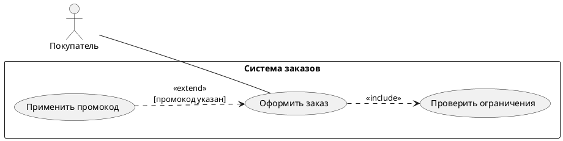
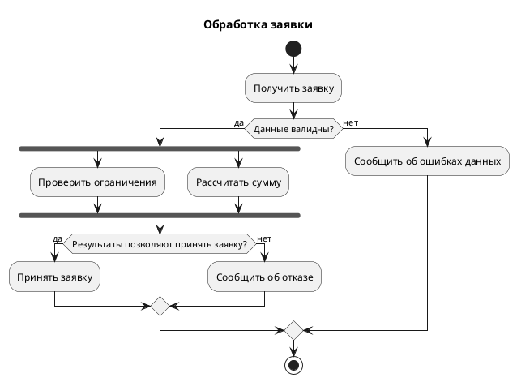
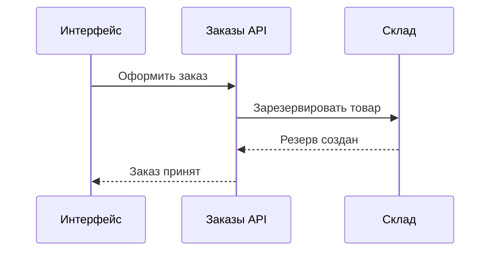
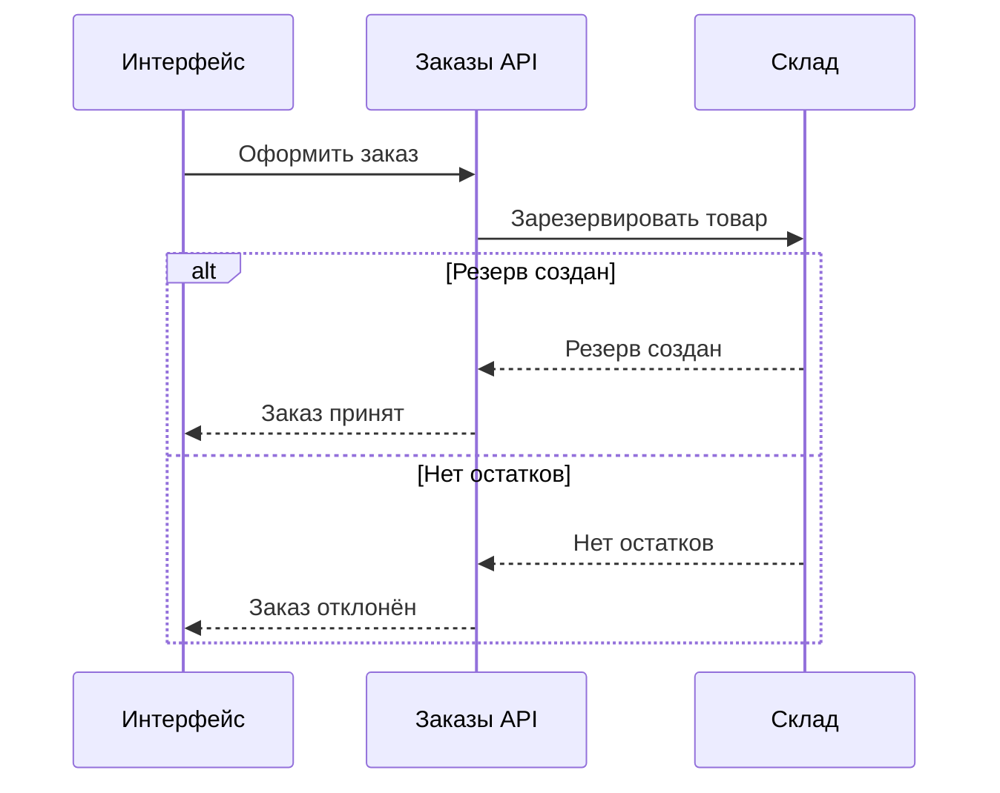

# Примеры создания и точечной правки

Имена, правила и значения ниже — условные учебные данные. Не переносить их в реальную систему без источника.

## Новая Use Case

Условие: покупатель оформляет заказ; проверка ограничений обязательна; промокод применяет по желанию. Вопрос — о целях и границе системы, не о порядке вызовов.

Проверить: `include` направлен к обязательному поведению, `extend` — к базовому прецеденту; актор вне границы. Не добавлять авторизацию без требования.

## Новая Activity

Условие: неверные данные отклоняются; для корректной заявки проверка ограничений и расчёт суммы выполняются параллельно; обе завершаются до решения. Раннюю отмену источник не задаёт.

Проверить: join после запущенных параллельных веток, альтернативные исходы сходятся через merge, все результаты завершаются. Не добавлять БД/HTTP-коды без источника.

## Правка Sequence с сохранением ID

Исходник:

Запрос: склад также отвечает «Нет остатков»; после этого заказ отклоняется. Другие гарантии/коды не заданы.

Исправленный исходник:

Дельта: единственный успешный ответ заменён взаимоисключающими исходами. Алиасы, участники, комментарий и запросы сохранены. Успех внутри успешной ветки; после отказа нет общего «Заказ принят». HTTP-коды, повторы и компенсации не придуманы.

## Только оформление

Запрос «сделай читабельнее, поведение не меняй» разрешает компоновку, переносы подписей и визуальные группы. Сравнить до/после: участники/связи, направления/типы, условия, порядок и исходы должны совпасть. Если упрощение требует изменения модели или разделения файла, показать это отдельным предложением.

## Несогласованные схемы

Если Use Case говорит «Оформить заказ», Activity завершает сценарий после оплаты, а Sequence принимает заказ до оплаты, проверить источники. Не выбирать произвольный вариант. Уточнить смысл «принят», момент статуса и источник текущего/целевого поведения. Внести только подтверждённую разрешённую дельту.
