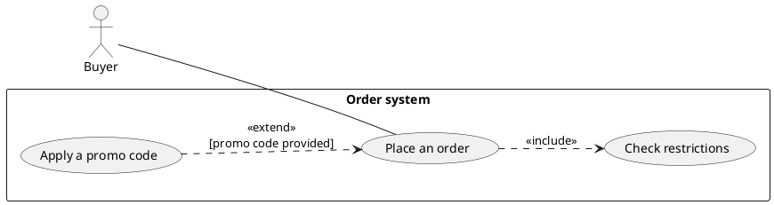
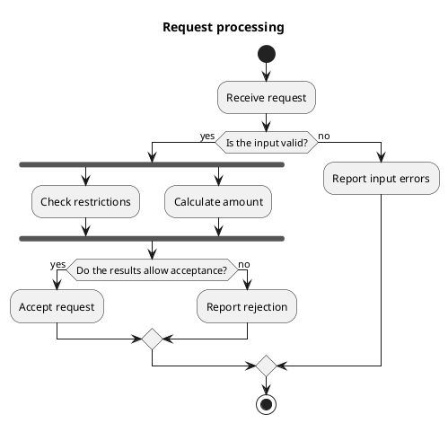
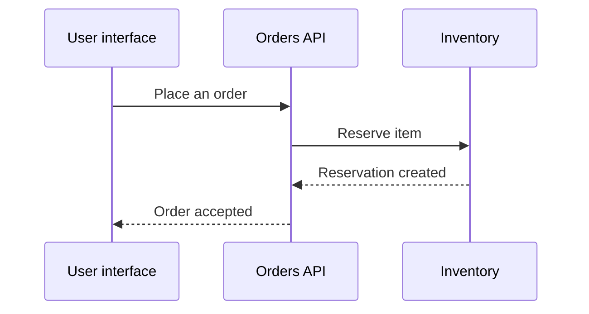
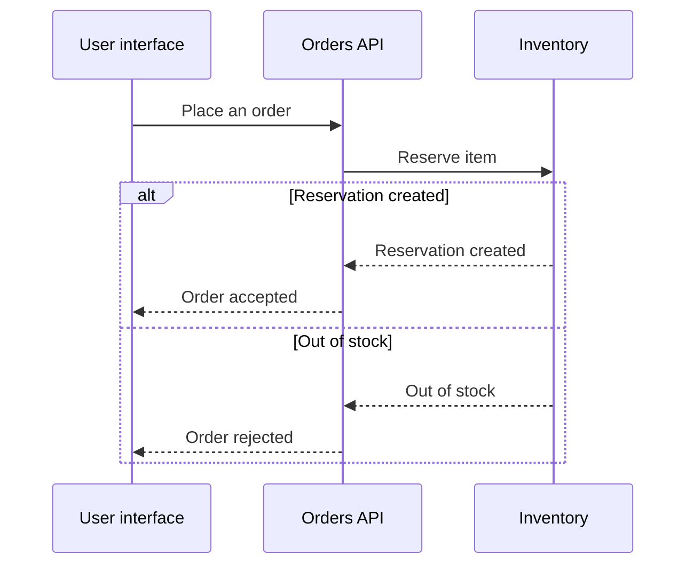

# Creation and targeted-edit examples

Names, rules, and values below are fictional teaching examples. Do not apply them to a real system without a source.

## Create a Use Case diagram

Given: a buyer places an order; checking restrictions is mandatory; applying a promo code is optional. The question concerns goals and the system boundary, not call order.

Check: `include` points to the mandatory behavior, `extend` points to the base use case, and the actor is outside the boundary. Do not add authentication without a requirement.

## Create an Activity diagram

Given: invalid input is rejected; for a valid request, checking restrictions and calculating the amount run in parallel; both finish before a decision. The source does not specify early cancellation.

Check: the join follows parallel branches that were started, alternatives converge through merge, and all outcomes finish. Do not add a database or HTTP codes without a source.

## Edit a Sequence diagram while preserving IDs

Original source:

Request: inventory may also return "Out of stock"; reject the order after that response. No other guarantees or response codes are specified.

Edited source:

Delta: replace the single success response with mutually exclusive outcomes. Preserve aliases, participants, the comment, and requests. Keep success inside the successful branch; no shared "Order accepted" follows a failure. Do not invent HTTP codes, retries, or compensations.

## Layout-only edit

"Make it more readable without changing behavior" permits changes to layout, label wrapping, and visual groups. Compare before and after: participants/relationships, directions/types, conditions, order, and outcomes must match. If simplification requires changing the model or splitting the file, present it as a separate proposal.

## Inconsistent diagrams

If Use Case says "Place an order", Activity finishes after payment, and Sequence accepts the order before payment, check the sources. Do not choose an arbitrary interpretation. Establish what "accepted" means, when the status is reached, and which source describes current or target behavior. Apply only a confirmed, authorized delta.
